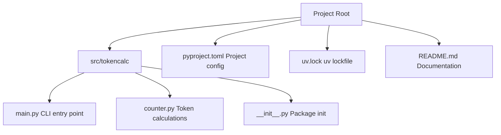

# TokenCalc

Anthropic (Claude)、OpenAI (GPT)、および **Google (Gemini)** の各モデルで使用される「トークン数」を、ローカルディレクトリ内のファイルを対象に非同期で一括計測・集計するための Python CLI ツールです。

## 特徴

- **マルチモデル対応**: OpenAI の `tiktoken`、Anthropic の公式 SDK、および Google の `google-genai` を使用して計算。
- **高速な非同期・並行処理**: `asyncio` を用いてディレクトリ内のファイルを並行処理し、大規模なプロジェクトでも高速に集計。
- **モダンなパッケージ管理**: [uv](https://github.com/astral-sh/uv) を採用し、高速かつ再現性の高い環境構築を実現。
- **ディレクトリ走査**: 指定されたディレクトリを再帰的に走査し、多様なテキストファイル（`.py`, `.r`, `.sql`, `.md`, `.cpp`, `.ts`, `.qmd` 等）のトークン数を個別および合計で集計。
- **スマート・フォールバック**:
  - **Anthropic**: `ANTHROPIC_API_KEY` が設定されていない場合、Claude 3 系のトークナイザーに近い `tiktoken` (cl100k_base) による近似値を算出。
  - **Google**: `GOOGLE_API_KEY` が設定されていない場合、`tiktoken` の値に係数を掛けた近似値を算出。

## セットアップ

### 前提条件
- Python 3.10 以上
- [uv](https://github.com/astral-sh/uv) がインストールされていること

### インストール
リポジトリをクローンした後、プロジェクトディレクトリで以下を実行して仮想環境と依存関係をセットアップします：

```bash
# 依存関係のインストールと仮想環境の同期
uv sync
```

## 使用方法

### トークン計算の実行
`uv run TokenCalc` コマンドに対象ディレクトリを指定して実行します。

```bash
# カレントディレクトリを対象にする場合
uv run TokenCalc .
```

### 出力例
```text
Scanning directory: . (OpenAI: gpt-4o, Google: gemini-2.0-flash, Concurrency: 10)
------------------------------------------------------------
src/tokencalc/counter.py: Anthropic=499, OpenAI=499, Google=549
src/tokencalc/main.py: Anthropic=664, OpenAI=664, Google=730
...
------------------------------------------------------------
Processed 10 files.
Total Anthropic Tokens: 1787
Total OpenAI Tokens:    1787
Total Google Tokens:    1966
```

### オプション
- `--model`: `tiktoken` で使用する OpenAI モデルを指定（デフォルト: `gpt-4o`）
- `--google-model`: Google (Gemini) のモデルを指定（デフォルト: `gemini-2.0-flash`）
- `--concurrency`: API リクエストの同時並行実行数を指定（デフォルト: `10`）

```bash
# OpenAI モデルを指定して実行
uv run TokenCalc . --model gpt-3.5-turbo

# Google モデルや並行度も指定
uv run TokenCalc . --model gpt-4o --google-model gemini-1.5-pro --concurrency 20
```

## プロジェクト構造



## 対象ファイルと除外設定

- **対象拡張子**:
  - コード: `.py`, `.r`, `.sql`, `.cpp`, `.c`, `.h`, `.hpp`, `.ino`, `.js`, `.ts`, `.html`, `.css`
  - ドキュメント・データ: `.txt`, `.md`, `.qmd`, `.rmd`, `.tex`, `.rnw`, `.Rnw`, `.yml`, `.yaml`, `.json`
- **自動除外ディレクトリ**:
  - `.git`, `__pycache__`, `.venv`, `venv`, `node_modules`, `.mypy_cache`, `.pytest_cache`, `.idea`, `.vscode`, `docs/Artifacts`

## 注意事項

- **Anthropic API キー**: `ANTHROPIC_API_KEY` 環境変数が設定されている場合、公式 API を通じた高精度な計測を行います。設定されていない場合は `tiktoken` (cl100k_base) による近似値となります。
- **Google API キー**: `GOOGLE_API_KEY` 環境変数が設定されている場合、Gemini の公式 API でトークン数を計測します。設定されていない場合は `tiktoken` ベースの近似値となります。

## ライセンス

MIT License
